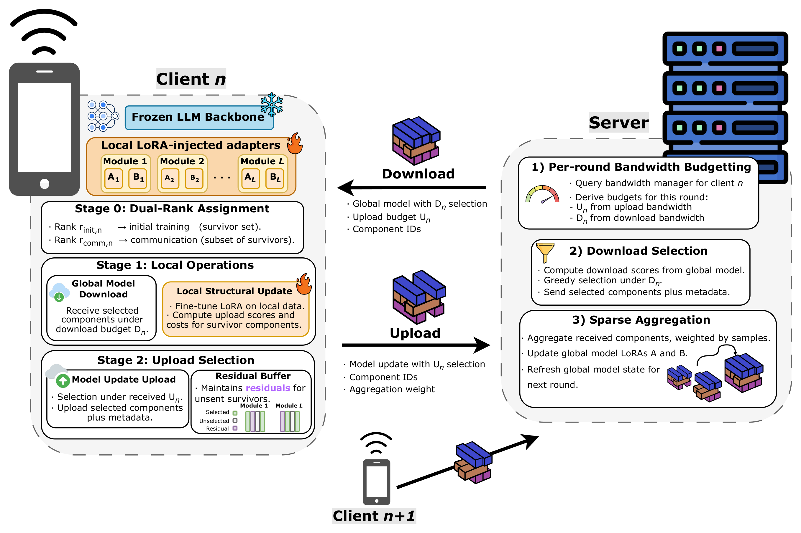
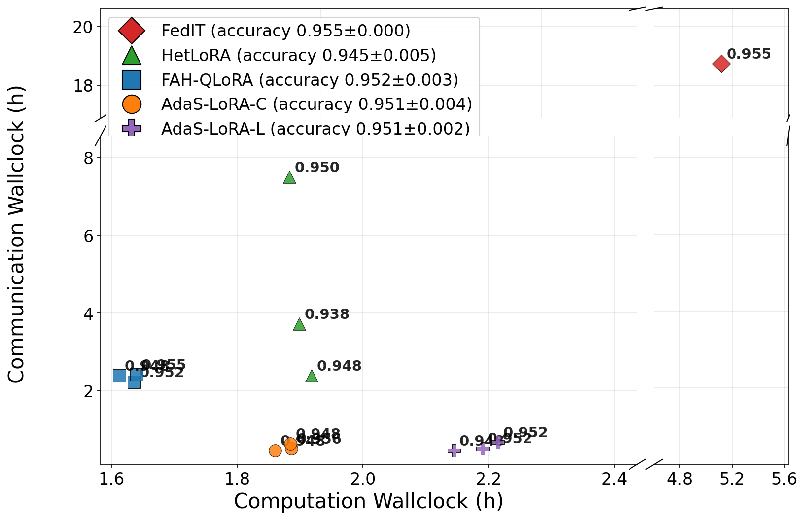

# AdaS-LoRA: Efficient Federated LLM Tuning in Edge Systems by Decoupling Compute and Network

This repository contains a revised implementation of AdaS-LoRA, the method of our paper
*AdaS-LoRA: Efficient Federated LLM Tuning in Edge Systems by Decoupling Compute and Network* (IEEE ICDCS Workshops,
FFME 2026). 

AdaS-LoRA separates the two resources that federated LoRA usually ties to a single rank: local compute and wireless
bandwidth. Each client's adapter is treated as a set of globally indexed rank-1 LoRA components. Stage 1 sets the
**compute rank** by learning-driven structural pruning of weak components. Stage 2 sets the **communication rank** by
selecting, under per-round uplink and downlink bit budgets, which surviving components are uploaded and downloaded.
Unsent updates are kept in residual buffers, and the server aggregates each component only over the clients that
uploaded it.

In this release, we include federated fine-tuning on GLUE with DeBERTa-large and simulated clients. 
The real-device deployment used in the paper is not currently included.

<p align="center">
  
  
</p>

## Methods

| Method | `federate.method` | Config |
| --- | --- | --- |
| AdaS-LoRA | `adas` | [configs/adas.yaml](configs/adas.yaml) |
| AdaS-LoRA, layer-aware (components identified per LoRA layer) | `adas_layeraware` | [configs/adas_layeraware.yaml](configs/adas_layeraware.yaml) |
| AdaS-LoRA, prune-only ablation (stage 1 without stage 2) | `adas_pruneonly` | [configs/adas_pruneonly.yaml](configs/adas_pruneonly.yaml) |
| FedIT (homogeneous rank) | `FedAvg` | [configs/fedit.yaml](configs/fedit.yaml) |
| HetLoRA | `hetlora` | [configs/hetlora.yaml](configs/hetlora.yaml) |
| FAH-QLoRA | `fah_qlora` | [configs/fah_qlora.yaml](configs/fah_qlora.yaml) |

The `*_quantized.yaml` configs run the same baselines with a mix of base-model precisions across clients; run
them directly, e.g. `python federatedscope/main.py --cfg configs/fedit_quantized.yaml data.type rte@glue`.

The layer-aware variant requires each client's downlink budget to cover all of its surviving components; a
partial downlink stops the run with an error. AdaS-LoRA itself supports partial downlinks.

## Project Structure

```
├── configs/                    # one config per method
├── scripts/run_glue.sh         # run a method on a GLUE task
├── data/                       # datasets and network traces (not tracked, see data/README.md)
├── requirements/requirements.txt
└── federatedscope/
    ├── main.py                 # entry point
    ├── glue/                   # GLUE data loading, DeBERTa model building
    ├── contrib/
    │   ├── common/             # rank-1 component scoring, pruning and budgeted selection;
    │   │                       # bandwidth manager and network-trace loader
    │   ├── trainer/            # per-method GLUE trainers
    │   └── worker/methods/     # per-method clients and servers
    └── core/                   # FederatedScope runner, workers, aggregators and configs
```

## Requirements

Tested with Python 3.10, PyTorch 2.1.0 and CUDA 12.1.

```bash
conda create -n adas python=3.10 -y && conda activate adas
pip install torch==2.1.0 --index-url https://download.pytorch.org/whl/cu121
pip install -r requirements/requirements.txt
pip install -e .
```

## Data Preparation

GLUE and `microsoft/deberta-large` are downloaded from the Hugging Face Hub on first use. `scripts/run_glue.sh`
uses trace-driven client bandwidth by default and reads 4G LTE traces from `data/4Gnetwork_trace/`; see
[data/README.md](data/README.md). Set `NET=generated` to run without traces (the configs alone use generated
bandwidth).

## Run

```bash
bash scripts/run_glue.sh <method> <task> [key value ...]

bash scripts/run_glue.sh adas rte
DEVICE=1 GAMMA=0.80 RW=0.005 UL_S=460 bash scripts/run_glue.sh adas_layeraware mrpc
bash scripts/run_glue.sh fedit sst2 seed 51
```

The script sets the per-task federation (6 clients for RTE, MRPC, CoLA and STS-B; 12 for SST-2, QNLI, QQP and
MNLI) and, for the heterogeneous-rank methods, assigns client LoRA ranks from {64, 120, 150, 200}. Method
hyperparameters are set through environment variables documented at the top of
[scripts/run_glue.sh](scripts/run_glue.sh). For AdaS-LoRA, the paper uses the pruning intensity η (`GAMMA`) in
{0.50, 0.65, 0.80}, the regularizer weight (`RW`) in {0.005, 0.05, 0.1} and the uplink window (`UL_S`) in
{230, 460} s, with a 63 s downlink window (`DL_S`). Logs and metrics are written to `exp/`.

Unit tests:

```bash
pytest federatedscope/contrib/common
```

## Citation

```bibtex
@inproceedings{espinosa2026adaslora,
  title     = {AdaS-LoRA: Efficient Federated LLM Tuning in Edge Systems by Decoupling Compute and Network},
  author    = {Espinosa, Pablo and Liebe, Lucas and Nguyen, Thanh-Tung and Tau, Nhat-Quang and Wu, Yuheng and Lee, Dongman},
  booktitle = {IEEE International Conference on Distributed Computing Systems Workshops (ICDCSW), Workshop on Federated Foundation Models at the Edge (FFME)},
  year      = {2026}
}
```

## Acknowledgement

This code is built on [FederatedScope](https://github.com/alibaba/FederatedScope) and FederatedScope-LLM
(Apache-2.0). See [NOTICE](NOTICE).
